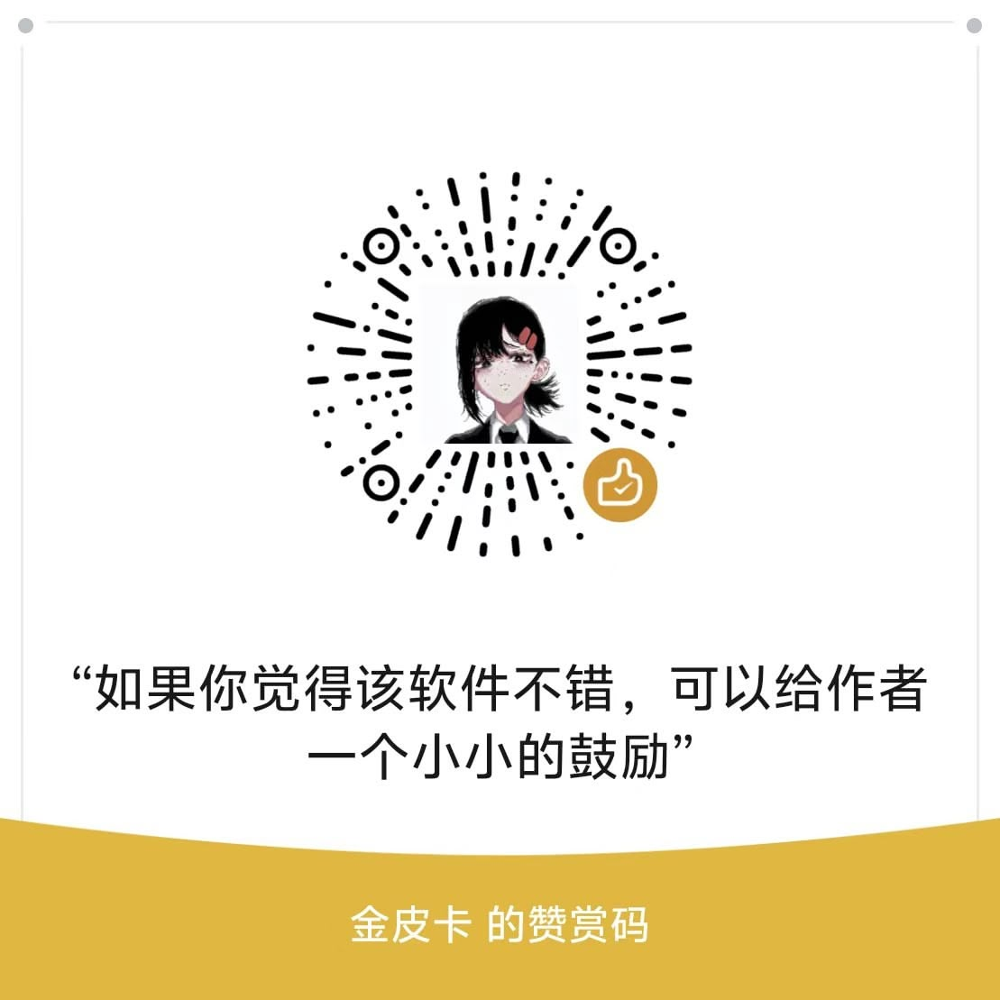

  

# dsh-preset-hotswap

> **拥有**：`/dsh-preset-hotswap` 路由（GET 模式名单 / POST 切换）与会话头部的模式下拉。
> **冲突时**：与官方模式徽标共用 slot `conversation.session.header.actions`，靠 order 排布；轮次进行中一律拒切。
> **回滚**：删 profile `cordis.patch.yml` 里 id `preset-hotswap` 的 insert + 从 `dependencies` 移除 + 完全重启应用。

会话头部「对话模式」热切换：**已经开始的会话也能切** 标准 / PTC / 创造。

## 它解决什么

官方只允许在会话开始前选模式。本插件在会话头部的官方模式徽标旁加一个下拉，
让进行中的会话也能换模式。切换后的三个可预期后果：

- 会话投影前移 → 官方模式徽标自动更新（不必刷新）；
- 该会话的前缀 KV cache 失效一次 —— 工具目录变化带来的固有代价，不是 bug；
- 重启后按投影的终值恢复，不需要额外持久化。

## 实现

- **host 半边**：经 `/dsh-preset-hotswap` 暴露名单（GET）与切换（POST）。
  切换链路是 `ctx.agents.get(sessionId)` 拿活体 agent →
  `ctx.agentPresets.resolve()` / `recompose(agent.ctx, id)` →
  `session.append("agent-preset/selected")` 推进投影；
  `recompose` 自身带 retain + bind(rebind)，旧 generation 按引用保留。
- **守卫**：轮次进行中拒切（`sessionProjections.stateOf(agent.session, "turnBoundary").openTurnStartSeq !== null`），
  与官方 `select()` 的 `agent-preset/locked` 锁处在同一层语义上。
- **client 半边**：纯 DOM 客户端模块，下拉注册在 slot
  `conversation.session.header.actions`（官方模式徽标也在那里，靠 order 排布）。

## 安装

desktop profile（Electron 独占 CLI，只能手改）：

1. `package.json` 的 `dependencies` 加 `"dsh-preset-hotswap": "link:../../local-plugins/dsh-preset-hotswap"`；
2. `cordis.patch.yml` 写 `insert: {id: preset-hotswap, name: dsh-preset-hotswap}`；
3. `pnpm install` 后**完全重启应用**（client bundle 在 host 启动时读入内存，刷新页面无效）。

回滚：删掉 insert 块与依赖行，重启。

---

## ☕ 赞赏支持

如果 dsh-preset-hotswap 对你的研究与测试有所帮助，欢迎请作者喝杯咖啡 ☕

  
  

  <b>给项目点个 Star ⭐</b> 同样是对开发者最大的鼓励！

